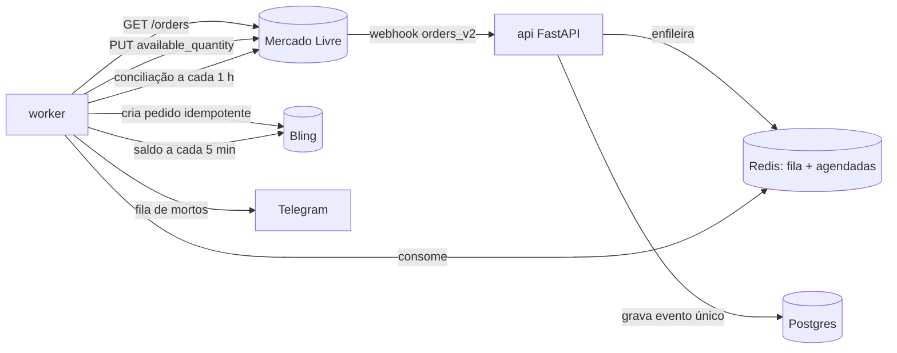

# pontelo

> Status: **fases 1–3 e 5 prontas**, 26 testes contra APIs falsas. **Bling real validado** (pedido criado sem duplicar).
> ML aguardando aprovação do app. Onde paramos e como retomar: [`docs/fase4.md`](docs/fase4.md). Plano: [`docs/plano.md`](docs/plano.md).

**pontelo** (ponte + elo): integrador entre **Mercado Livre** e **ERP** (Bling).
Pedido vendido no ML entra sozinho no ERP, estoque do ERP atualiza o anúncio, e nenhuma
falha se perde: erro de rede, token vencido e limite de requisição viram nova tentativa
automática, com alerta quando precisa de gente.

## Números (teste de carga com falha injetada)

`CARGA_N=1000 pytest -k carga -s`: 1.000 pedidos, cada aviso entregue 1 a 3 vezes,
**20% das chamadas ao ML e ao Bling falhando ao acaso** (500, 503 ou 429), 2 workers.

| | |
|-|-|
| Pedidos no ERP na primeira passada (até 6 tentativas) | 996 |
| Esgotaram as tentativas e foram para a fila de mortos, com alerta | 4 |
| Depois de "reprocessar" no painel | 1.000 |
| **Duplicados** | **0** |
| **Perdidos** | **0** |

## Arquitetura



- **Fonte da verdade:** o ML manda no pedido, o ERP manda no estoque. Não há lógica de "quem ganha".
- **Duplicidade:** existem três barreiras.
  - O aviso do ML é gravado com id único (`_id`); repetido é ignorado.
  - Antes de importar, o worker confere a tabela de vínculos ML↔ERP.
  - Antes do POST, o worker procura no ERP pelo número do ML. Isso cobre o caso em que
    o POST funcionou mas a resposta se perdeu.

## O que o projeto prova

| Tema | Onde |
|------|------|
| OAuth 2.0 com renovação automática, cifrada (Fernet), com trava por linha: N workers, 1 renovação | `app/oauth.py` |
| Webhook idempotente; aviso de outro `application_id` ou de outra conta é ignorado | `app/webhooks.py` |
| Fila com retentativa (30 s → 6 h), fila de mortos e recuperação de worker morto no meio (LMOVE) | `app/fila.py` |
| Renova uma vez em 401, espera `Retry-After` em 429; 4xx vai direto para mortos | `app/http.py` |
| Conciliação horária (pega o que o webhook perdeu) e limpeza de payload com mais de 30 dias (LGPD) | `app/conciliar.py` |
| Adaptador por ERP: trocar Bling por Tiny sem mexer no núcleo | `app/erp/` |
| Painel `/admin` com senha: pedidos, fila, tokens, mapa de SKU, reprocessar mortos | `app/admin.py` |
| APIs falsas de ML e Bling com falhas sob demanda; testes sem rede | `tests/falsos/`, `tests/` |

## Rodar

```sh
cp .env.example .env        # preencher FERNET_KEY e ADMIN_SENHA (comandos no arquivo)
docker compose up -d --build api worker falsos
sh scripts/demo.sh          # conecta, mapeia SKU, simula venda + 3 avisos repetidos, muda estoque
docker compose run --rm testes                     # 25 testes
docker compose run --rm testes ruff check .        # lint
```

Painel em `http://localhost:8000/admin` (qualquer usuário, senha `ADMIN_SENHA`).

Contas reais: definir `ML_*`, `BLING_*` e `BASE_URL` (túnel HTTPS) no `.env`. Lista em `.env.example`.

## Limites conhecidos

- Anúncio com variações: a atualização de estoque não trata `variations` (só `available_quantity` do item).
- Estoque por polling de todos os SKUs mapeados a cada 5 min. Com milhares de SKUs, usar o webhook do ERP.
- O limitador de 429 espera dentro do worker. Com muitos workers, o próximo passo é um limitador por provedor no Redis.
- As migrações rodam via `docker-entrypoint-initdb.d`, ou seja, só com o banco vazio.
- Conta única por provedor (`principal`). Multi-loja está fora de escopo.

## Stack
Python 3.12 · FastAPI · PostgreSQL 16 · Redis 7 · httpx · Docker Compose · Telegram (alertas).

## Dados
Só contas de teste e dados inventados. Nada de pedido, cliente ou token reais no repositório.
